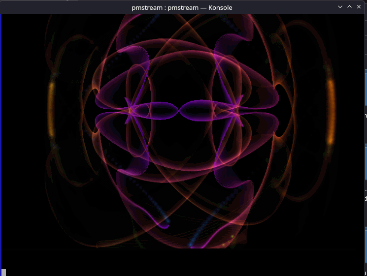

# pmstream

Run [projectM](https://github.com/projectM-visualizer/projectm) winamp style visualizations in the terminal or inside kew.

[Watch the demo on YouTube](https://www.youtube.com/watch?v=ksNUZYZyRJA)

<div align="center">
    
</div>
<br /><br />

Technical details:

Run projectm headless and stream the rendered frames to stdout as ASCII or sixels. It is built to feed music visualizations to the terminal music player [kew](https://kewplayer.com), but works with anything that can read the frame protocol below.

No window is needed: pmstream renders offscreen through a surfaceless EGL context, listens to an audio input device, and writes each frame to stdout.

THIS WORKS AS STANDALONE OR WITH KEW 4.4.2 OR MANUAL BUILD OF KEW FROM THE MAIN REPO.


## How to install

This only works in linux for now.

1. First install meson. Here are commands for some distros

```sh
# Debian / Ubuntu / Mint
sudo apt install meson ninja-build

# Fedora / RHEL / Rocky
sudo dnf install meson ninja-build

# Arch / Manjaro
sudo pacman -S meson ninja
```

2. Run the following commands. They will install projectM, Cream of the Crop Preset Pack and pmstream.

```sh
./setup-deps.sh
meson setup build
meson compile -C build
sudo meson install -C build
```

If used with kew 4.4.2 or later, your default visualization plugin will now be pmstream and you can run it and cycle presets by pressing c in track view. Press b to turn it off.

## Dependencies

- [projectM](https://github.com/projectM-visualizer/projectm) (including `projectM-4-playlist`)
- [chafa](https://hpjansson.org/chafa/) (sixel mode)
- EGL and OpenGL (e.g. Mesa)
- A set of projectM presets

## Manual Build

```sh
gcc -O2 -o pmstream pmstream.c \
    -I/usr/local/include $(pkg-config --cflags --libs chafa) \
    -L/usr/local/lib -Wl,-rpath,/usr/local/lib \
    -lprojectM-4-playlist -lprojectM-4 -lEGL -lGL \
    -lpulse-simple -lpulse -lpthread
```

## Manual Install

```sh
sudo cp pmstream /usr/local/bin
```

## Usage

```sh
pmstream --stream 80x40 --mode ascii [--preset random|N] [--preset-interval 60]
pmstream --stream 80x40 --mode sixels [--cell-size 8x16] [--fps 15]
          [--audio-device NAME] [--presets DIR]
pmstream --list-devices
```

| Option | Description | Default |
|---|---|---|
| `--stream WxH` | Output size in character cells | `80x40` |
| `--mode ascii\|sixels` | Output format | `ascii` |
| `--fps N` | Frames per second | 30 (ascii), 24 (sixels) |
| `--cell-size WxH` | Cell size in pixels (sixels only) | Detected from terminal, else `8x16` |
| `--preset random\|N` | Shuffle presets, or pin to preset number `N` | `random` |
| `--preset-interval S` | Seconds between preset changes | `25` |
| `--sendinfo` | Displays author and preset name on the bottom row for 3 seconds  |
| `--presets DIR`, `-p DIR` | Preset directory | Searches `~/.local/share/projectM/presets` and `/usr/(local/)share/projectM/presets` |
| `--audio-device NAME` | SDL audio capture device | System default | |

Pass the name of a monitor/loopback device to `--audio-device` to visualize what is currently playing.


## ProjectM Presets

The preset files define the visualizations via pixel shaders and Milkdrop-style equations and parameters.

The projectM library does not ship with any presets. The frontends come with varying preset packs which can be found in
separate repositories in the projectM repository list:

- [Base Milkdrop texture pack](https://github.com/projectM-visualizer/presets-milkdrop-texture-pack) - Recommended for
  use with _any_ preset pack!
- [Cream of the Crop Pack](https://github.com/projectM-visualizer/presets-cream-of-the-crop) - A collection of about 10K
  presets compiled by Jason Fletcher. Currently, projectM's default preset pack.
- [Classic projectM Presets](https://github.com/projectM-visualizer/presets-projectm-classic) - A bit over 4K presets
  shipped with previous versions of projectM.
- [Milkdrop 2 Presets](https://github.com/projectM-visualizer/presets-milkdrop-original) - The original preset
  collection shipped with Milkdrop and Winamp.
- [En D Presets](https://github.com/projectM-visualizer/presets-en-d) - About 50 presets created by "En D".

## Frame protocol

Each frame is one block terminated by `\n\n`.

- **ascii**: rows separated by `\n`, with a 24-bit ANSI color per cell.
- **sixels**: a single DCS sixel sequence (newlines stripped), followed by `\n\n`.

Frames go to the original stdout. Anything else the program prints (log messages, warnings) goes to stderr. Note that kew drops frames of 8 MiB or more, so keep sixel sizes reasonable.

## Credits

* ProjectM by projectM Team - https://github.com/projectM-visualizer/projectm
* Chafa by Hans Petter Jansson - https://hpjansson.org/chafa/

## License

GPLv2. Copyright (C) 2026 Ravachol.

